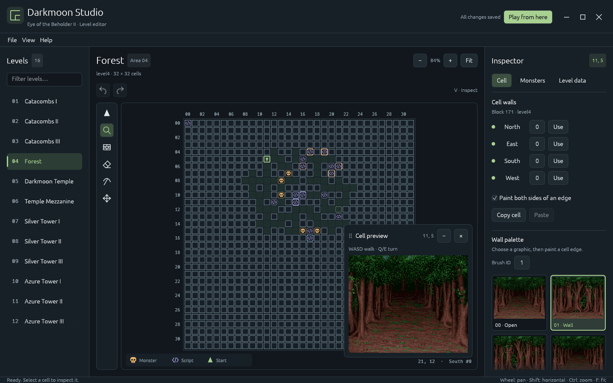

# Eye2 reverse engineering workbench

This project analyzes the supplied DOS **Eye of the Beholder II v1.1** installation and makes its assets editable. The Rust extractor, compressor, repacker, executable analyzer, and SDL asset viewer run natively. **The complete game currently runs through DOSBox Staging. This is not a finished Rust game engine or a source-to-source conversion.**

The supplied game directory is read only. Exported originals live in `assets/raw/`; rebuilt game files and writable saves live in `runtime/`.

## Required files and locations

You must supply your own **complete installed DOS Eye of the Beholder II v1.1
game directory**, including `start.exe` and its accompanying game data files.
These original game files are not included in this repository, and
`tools/bootstrap.py` does not download them. Supplying only the executable is
insufficient.

Keep the original installation in any directory you choose, then pass that
directory to `extract --source`. `/home/dcoulombe/Games/DOS/EYE2` is the path used
in this local setup and the CLI default; you do not need to recreate it. On Linux,
the source directory must contain a file named exactly `start.exe`.

| Location | How it is populated |
| --- | --- |
| `/path/to/your/EYE2/` | You provide the complete original DOS installation here. Use this directory as `extract --source`. |
| `assets/` | `extract` generates editable assets and preserves the original files in `assets/raw/`. |
| `runtime/` | `pack`, or `play` with its default repacking, generates a separate playable game directory, including `runtime/start.exe`. Saves are written here. |
| `target/release/eye2` | Cargo generates the native Linux application with `cargo build --release --locked`. The launchers prefer this executable, and the screenshot script requires it. |
| `target/debug/eye2` | Cargo generates the native debug executable with `cargo build --locked` or the default `cargo run`. |

The native `eye2` executable and the original DOS `start.exe` are separate
programs. `target/`, `assets/`, and `runtime/` are ignored by Git and are absent
from a fresh clone. Let the commands generate their contents; no manual copying
into these directories is needed. Run the setup commands below from the repository
root.

## Native Linux level editor

**Darkmoon Studio** is a native Rust desktop application. It opens the extracted levels directly and requires no DOS runtime or browser.



```sh
./edit-levels.sh
```

In this local checkout, the optimized Linux executable is already built at `target/release/eye2`. For a fresh clone, generate it with `cargo build --release --locked` after extracting the game assets as described below. `edit-levels.sh` launches it with the editor command. You can also launch the provided `DarkmoonStudio.desktop` entry from the project folder. For a different extracted asset project:

```sh
./edit-levels.sh --assets /path/to/assets --runtime /path/to/export --level 4
```

Capture the editor as a PNG using the existing release executable:

```sh
./screenshot.sh
./screenshot.sh verification/level-4.png --level 4
```

The default output is `verification/screenshot.png`, replaced on each run. Every
successful capture also refreshes `resources/darkmoon-studio-screenshot.png`, the
image displayed above, even when a custom output path is specified. The script
opens a fresh editor on a private Xvfb display and closes it after capture,
so it works without a desktop session and leaves any open editor alone. It does
not capture unsaved changes from an existing editor window. Requires ImageMagick's
`import`, `xwininfo`, and either system Xvfb or the copy under `tools/xvfb/`.

On deploy requests, create an annotated Git tag starting at `v0.0.1` when there are
no version tags. Subsequent deploys increment the patch version unless another
version or increment is specified; see `AGENTS.md` for the project instructions.

The editor includes:

- All 16 game areas, sublevels, and their actual map references. Shared maps are clearly identified, and edits stay shared between areas using the same map.
- A zoomable map canvas with coordinate rulers, skull icons for monster spawns, code icons for script bindings, a preview direction arrow, and optional wall IDs. Grouped monsters show a count; hover an entity cell for spawn IDs, types, facing, and script binding details. The **Monsters** and **Scripts** toggles in **View** control their icons; **Wall IDs** controls wall labels.
- A vertical icon toolbar to the left of the map for **Start point**, **Inspect**, **Wall**, **Erase**, **Carve**, and **Move spawn**. The active tool is highlighted; hover an icon for its name and keyboard shortcut. Undo and Redo remain above the viewport; display options are in **View**.
- A first-person **Cell preview**, initially in the lower-right corner, using the original perspective tiles and sprites. Drag its title bar to move it within the map viewport; double-click the title bar to reset its position. Use **−** to minimize it to its title bar, **+** to restore it, or **×** to close it. **View → Preview** toggles visibility and reopens a hidden preview expanded. Use **Start point (P)**, the first tool, or **Ctrl+Click** a cell with any tool to place the preview and playtest start, then use **Q / E** to turn and **WASD** to walk. The start point's arrow shows the facing direction and remains visible when the preview panel is hidden.
- Wall painting, erasing, passage carving, wall sampling, and optional editing of both sides of an edge. The wall palette has large graphic tiles showing each wall, door, or decoration in the area's actual art style; hover for a larger preview and passability details. Existing asymmetric walls stay intact until you edit them.
- Cell inspection, copy/paste, undo/redo with up to **100 actions** of session history, dirty-state indicators, and protection against silently overwriting files changed outside the editor. Each wall stroke and entity drop counts as one action. Saving keeps history, and a new edit replaces any redo actions.
- Movement and property editing for existing initial monster spawns, with sprite previews and editable monster-type statistics.
- Searchable decoded level fields for timers, wall mappings, monster properties, and resource references.
- A left-aligned **File / View / Help** menu bar sits below the title bar. **File** contains **Save all**, **Export game files…**, and **Reload from disk…**; **View** contains display toggles; **Help** contains **Editor help**. Save writes editable JSON; Export repacks assets into a separate game directory without launching DOSBox. The green **Play from here** button remains directly available in the header.

Choose **Inspect (V)** and drag a skull or code icon to move its entities to another cell. The drop target is highlighted; release to place, or press **Escape** to cancel. Groups move together, and each drop is one undoable edit. Script bindings cannot be dropped onto a cell with another script binding. Moving a script relocates its activation cell; its instructions and embedded block references stay intact. To move one monster from a group, choose it in **Inspector → Monsters**, then use **Move on map**. **Wall** and **Erase** affect the nearest cell edge; **Carve** excavates only the clicked tile and joins it to adjacent floor cells. Solid neighbors keep their walls, preserving the outline of the room or passage without creating a plus-shaped opening. Drag to excavate a sequence of tiles; this behavior is independent of **Paint both sides of an edge**. **Level data** edits the decoded properties and does not create additional spawn records.

Select a script icon (or inspect its tile), then choose **Edit event steps…**. The event editor shows named commands with forms for map coordinates, facing, characters, items, messages, conditions, and branch destinations. Choose a command and **Insert before selected**, replace a step, reorder it, or remove it. **Start at** chooses the entry step; the triangle marks that step. **Activation** edits the events that call the script. Branches and routine calls use step names, and referenced steps cannot be removed until their references are changed. **Apply changes** records the entire draft as one undoable edit; Save and Play from here also apply drafts. Closing an edited draft offers apply/discard choices. **Restore original event** is undoable. The editor preview does not execute these events; use **Play from here** to test them in the game.

Message text can be typed directly, with line breaks and `\xNN` escapes for DOS characters/control codes. Item templates show the game's item names. Dialogue commands select existing passages from `assets/texts/dialogue.json` and edit their button text; use **Show message** for new inline messages. Event steps support conditional comparisons and existing shared routines. Editing an event creates its own compiled copy, so other triggers using the original routine keep their original behavior.

The cell preview updates from unsaved edits, including undo/redo. Walk with **W/S** (forward/backward), **A/D** (sidestep), and turn with **Q/E**. Hold a key to keep moving. Movement follows the original game's destination-wall passability flags, including door states and custom wall definitions, and stops at the map boundary. Walking moves the preview and playtest start without editing the level or changing the inspected cell. Use **Inspect (V)** to click cells or use the arrow keys to inspect any location freely; inspecting and editing cells keeps the start point in place. Hide the preview with **View → Preview** when you need to edit cells underneath it. The preview displays geometry, decorations, doors, and initial monsters, but does not run combat, timers, animation, or level scripts; walking does not activate triggers, open doors, collide with monsters, or change levels.

Clicking an entity icon selects it without changing the highlighted cell or first-person preview position. Use **Locate** in the monster inspector or **Locate cell** on the selected script to inspect its cell. Clicking the map background with **Inspect (V)** selects a cell. Use **Start point (P)** or **Ctrl+Click** with any tool to move the preview and playtest start.

Click **Play from here** in the toolbar to test the current level in the full game. The party starts at the start point's arrow, facing the direction chosen in **Cell preview**, using the original quick-start party. Each character also receives a spare **+2 weapon** (long sword, short sword, mace, or staff), **two potions of extra healing**, and **two iron rations** in empty backpack slots; their existing equipment stays in place. Place it with **Start point (P)** or adjust it by walking in the preview. Current wall, monster, script, and resource edits are included even if you have not saved them. Preparation takes a few seconds; the game opens in a separate DOSBox window, skipping the intro and load menus. The editor stays open and keeps unsaved changes and undo history.

Use **Stop test**, or close the game window, to finish. Each launch uses a fresh temporary copy of the assets and game; cached level state is cleared so current edits take effect. Test saves are discarded when the test ends. Your original installation, exported runtime, and normal game saves stay untouched. Changes made while a test is running take effect on the next launch.

| Shortcut | Action |
| --- | --- |
| V / B / X / R / M | Inspect / wall / erase / carve / move spawn |
| P | Place the preview and playtest start point |
| Ctrl + click | Place the start point with any tool |
| W / S | Walk forward / backward with wall collision |
| A / D | Sidestep left / right with wall collision |
| Q / E | Turn left / right |
| Alt + click | Sample a wall ID |
| Middle-drag or Space-drag | Pan |
| Mouse wheel | Pan vertically |
| Shift + mouse wheel | Pan horizontally |
| Ctrl + mouse wheel / F | Zoom around the pointer / fit map |
| Arrow keys | Move the selected cell |
| Ctrl+C / Ctrl+V | Copy / paste a cell's walls |
| Ctrl+Z / Ctrl+Shift+Z or Ctrl+Y | Undo / redo (up to 100 actions) |
| Ctrl+S / Ctrl+Q | Save all / close |

The editor prompts before closing with unsaved edits. Reloading from disk explicitly discards unsaved changes and undo history. The original installation supplied to `extract --source` is never edited.

To rebuild the application after changing Rust source, run `cargo build --release --locked`. The launcher falls back to `cargo run` if the optimized executable is missing. Building requires Rust 1.95 or newer; the prebuilt executable uses the Linux desktop's OpenGL/X11 or Wayland libraries.

## Run

The local checkout is already extracted and has a working DOSBox Staging runtime installed under `tools/dosbox-staging/`.

```sh
cargo run --locked -- play
```

Choose **Load Game in Progress → QUICK START PARTY** to enter the forest immediately. The intro starts automatically on launch and is also available through **Run Introduction**. Walk with **W/S** (forward/backward), **A/D** (strafe left/right), and **Q/E** (turn left/right). These controls also work in **Play from here** tests. The mouse controls and numeric keypad remain available: 8 forward, 2 backward, 4/6 strafe, 7/9 turn. Hold **Scroll Lock** for normal letter input when entering character names or save descriptions. Release it to resume WASD + Q/E movement. Escape skips the intro. Ctrl+F9 exits DOSBox. Saves remain in `runtime/` between repacks.

For a fresh checkout, first place your complete original DOS installation in a
directory of your choice. Replace `/path/to/your/EYE2` below with that directory
(the one containing `start.exe` and the accompanying game data):

```sh
python3 tools/bootstrap.py
cargo run --locked -- extract --source "/path/to/your/EYE2"
cargo run --locked -- verify
cargo run --locked -- play
```

`extract` refuses to replace existing exports, so an accidental rerun will not erase edits. Use `--output another-directory` for a fresh extraction. Set `EYE2_DOSBOX=/path/to/dosbox` to select another emulator. The installed system DOSBox 0.74 crashes in its SDL compatibility renderer on this machine; the local Staging executable avoids that problem.

## Edit

| Location | Contents and editing rules |
| --- | --- |
| `assets/images/*.png` | All 116 original 320×200 image/sprite sheets. Keep dimensions and palette indices. |
| `assets/sprites/*/*.png` | 479 individual item, monster, decoration, and intro sprite crops. Changes overlay the corresponding sheet when repacked. |
| `assets/sprites/*/atlas.json` | Sprite locations in the sheet. Sprite crops take precedence where both crop and sheet were edited. |
| `assets/sprites/*.dec.json` | Wall decoration rectangles, positions, shapes, and flags. |
| `assets/sprites/*.dcr.json` | Monster decoration frames and placement. |
| `assets/fonts/*.png` | Both DOS bitmap fonts as editable glyph sheets. |
| `assets/palettes/*.json` | VGA palettes, 256 RGB triples in the range 0–63. |
| `assets/images/*.json` | Sheet palette and dimension metadata. Embedded palettes are repacked; shared palettes are edited separately under `palettes/`. |
| `assets/tiles/*.png` | Five dungeon tile atlases; preserve indices 0–15. |
| `assets/tiles/*.json` | Tile color maps and VMP references. |
| `assets/maps/level*.json` | All 15 32×32 maps. Each cell has north/east/south/west wall IDs. These are wall types, not just booleans. |
| `assets/scripts/level*.json` | All 16 decompressed INF files, named level data, and script bindings. `events` stores event-editor overrides by binding index. Edit `fields[].value` or relocate an existing `bindings[].block`; original offsets, record counts, and record sizes stay fixed. |
| `assets/items/items.json` | 434 item records and 123 names. Edit names, icons, positions, values, flags, and types. |
| `assets/items/types.json` | 64 item types, equipment restrictions, armor values, damage dice, and bonuses. |
| `assets/texts/dialogue.json` | 122 dialogue groups. Retain null separators and DOS control codes. Text offsets are rebuilt automatically. |
| `assets/texts/executable.json` | Fixed-size text strings recovered from START.EXE, including intro captions and menus. Translations must fit `max_bytes`; edit `text`, retaining offsets and sizes. Some automatically detected candidates may be binary data. |
| `assets/audio/*.adl.json` | Ten AdLib banks: track mapping, channel programs, named bytecode operations, note durations, and FM instruments. |
| `assets/audio/*.snd.json` | Ten PC-speaker banks, decoded into notes, durations, repeat loops, frequency changes, and timer scales. |
| `assets/audio/wav/` | Native Rust WAV previews of every distinct PC-speaker program, with an index of track aliases. |
| `assets/audio/music/` | AdLib music and musical cues as 44.1 kHz, 16-bit stereo WAVs, with a track/alias index and M3U playlist; generated with `tools/extract_music.py`. |
| `assets/data/` | Remaining data tables retained as lossless editable byte arrays. |

Indexed PNGs give exact palette control. RGB/RGBA sheets are mapped to the nearest existing palette color; alpha is not a new game feature. The indexed color 0 remains the original sprite transparency convention. Sprite crop exports include the original background index, so they can be pasted back without losing pixels.

Some sheets use different palettes in different levels or scenes. Their exported pixel indices are exact; a single preview palette cannot represent every runtime context.

After editing:

```sh
cargo run --locked -- verify
cargo run --locked -- pack
cargo run --locked -- play --no-pack
```

`play` normally repacks automatically. Unmodified files are copied byte for byte. Modified CPS, VCN, and INF files are encoded back to LCW compression, as required by the DOS loader. Invalid dimensions, pointer-moving changes, and out-of-range fields are rejected before writing runtime files. Quit the game before repacking its directory.

AdLib programs use fixed offsets because they contain relative branches and subroutines. Change note opcodes, arguments, instrument levels, attack/decay parameters, and priorities while preserving instruction/region sizes. Note opcodes below 128 encode octave × 16 + semitone (C = 0), followed by duration. An instruction's `operation` and `offset` fields are explanatory; `opcode` and `arguments` are authoritative. These banks are not ordinary MIDI files.

Export the original AdLib music without building the app:

```sh
python3 tools/bootstrap.py --adplay
python3 tools/extract_music.py
```

The exporter uses [AdPlay/AdPlug](https://adplug.github.io/) with Nuked OPL3
emulation and reads the original banks in `assets/raw/`. It includes channel-nine
music starters and short musical cues from all ten banks, excluding reset/fade
commands and ordinary sound effects. `assets/audio/music/index.json` maps WAVs to
their bank, track aliases, source hash, duration, and audio levels;
`playlist.m3u` plays the complete export. Playback ends at AdPlug's first-loop/end
detection or a 600-second limit, recorded as `duration_capped` in the index.
Use `--seconds N` to change the limit, `--assets PATH` for another asset project,
or `--output PATH` for another destination. Existing output directories are
protected from replacement. The bootstrap unpacks pinned Linux x86-64 Debian
binaries locally under `tools/adplay/`; a compatible system `adplay` or
`EYE2_ADPLAY` executable can also be used. These WAVs are derived previews, not
repack inputs; edit the AdLib JSON to change game audio. No MIDI export is
implemented.

The PC-speaker interpreter runs in Rust and can export standard 44.1 kHz mono PCM WAV previews. The oscillator uses a square wave; this is not a capture of a physical PC speaker. Long/looping programs are capped at 30 seconds by default, with `duration_capped` recorded in the index. Edit SND JSON to change game audio; the WAV files are derived previews and are not imported back into DOS sound programs.

```sh
cargo run --locked -- render-sounds
cargo run --locked -- render-sound --bank forest --track 12 --output preview.wav
```

INF `bytes` retain the complete original script and initialization data. Named `fields` override only values changed from the original, so unrelated byte edits are preserved. The event editor decodes reachable commands, conditions, and routines into editable steps stored in `events`. Packing compiles edited events into an extension, relocates their branches, rebuilds the message table, and redirects only their bindings. Original instructions keep their addresses; unrelated events keep their original behavior. Export size is limited to 64,000 decompressed bytes, and invalid references are rejected before an edit is applied. A native Rust script interpreter is not implemented. The `.inf.bin` files are inspection copies; edit JSON to repack.

## Native inspection

```sh
cargo run --locked -- native
```

Left/right browse image sheets, R reloads an edited sheet, M opens the map inspector, brackets change level, WASD inspect movement and facing, Escape exits. This viewer does **not** implement combat, quests, spells, AI, the intro animation player, or script execution.

## Recovered code

`analysis/decompiled/start.c` contains Ghidra's C-like output for 813 functions; four candidates failed decompilation. `functions.tsv` records the result for every function. Function names and types are inferred, segmented pointers need validation, and the output is not directly compilable source. The Rust analyzer also exports the MZ relocations, assembly listings, candidate functions, and executable strings:

```sh
cargo run --locked -- analyze
python3 tools/bootstrap.py --ghidra
bash tools/decompile.sh
```

The format reconstruction and Rust algorithms are informed by [ScummVM's Kyra engine](https://github.com/scummvm/scummvm/tree/master/engines/kyra). Cached reference files retain their copyright headers; `reference/SOURCES.json` records upstream locations and file hashes. The project code follows GPL-3.0-or-later. Original game data and recovered game code retain their original ownership and are not included as redistributable project assets.

## Validation and remaining engine work

`cargo test` exercises compression modes and codec roundtrips. `verify` forces every editable export through rebuilding and checks every untouched asset against its original, comparing decoded content for compressed formats. All 241 files pass. Gameplay verification screenshots and audio captures are under `verification/`; these cover the original intro, save loading, movement, turning, and collisions. They are smoke checks, not a complete campaign playthrough.

A complete Rust replacement still needs faithful scene composition, the full INF VM and expression evaluator, party creation/save compatibility, inventory/equipment UI, AD&D combat and spells, monster AI/timers, all conversations and sequences, and the AdLib playback driver. The native PC-speaker player is not yet integrated with a native gameplay engine. Running the DOS executable from Rust does not fulfill that conversion. The recovered code, decoded data, and reference engine are the starting evidence for that work.
